<div align="center">

# SE-JEPA: Self-Evolving Latent World Models

**Turning deployment experience into reusable predictive knowledge**

[](#citation)
[](#citation)
[](LICENSE)
[](https://www.python.org/)
[](https://pytorch.org/)

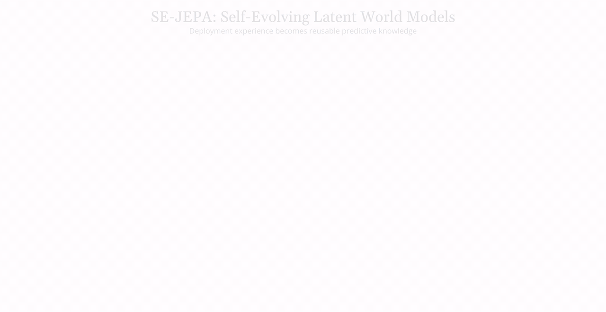

</div>

SE-JEPA lets a latent world model **keep learning across deployment episodes** without overwriting what it
learned in pretraining. Instead of carrying episode-specific weight updates forward, it replays the observed
interaction trajectories, groups compatible ones into **self-discovered predictive domains**, trains one
**slow predictor per domain**, and **retrieves** a validated predictor when a condition comes back. No domain
labels or domain-switch signals are needed, and it works with both gradient-descent (GD) and
cross-entropy-method (CEM) planners.

## Highlights

- **+15.4 to +17.1 points** held-out success over AdaJEPA on PushObj shapes unseen during pretraining, and
  **+15.9 to +18.7 points** on PushT visual shifts (GD and CEM).
- **65.3% → 75.5%** online success over five rounds of a single stream that mixes 14 shape and visual
  conditions, with one persistent memory.
- With a DINO-WM backbone, a predictor trained in **one consolidation pass** reduces Chamfer distance by
  **47%** on rope instances excluded from learning, without any within-episode adaptation.

## Contents

- [Method](#method)
- [Results](#results)
- [Repository structure](#repository-structure)
- [Getting started](#getting-started)
- [Citation](#citation)
- [Acknowledgements](#acknowledgements)

## Method

<p align="center">
  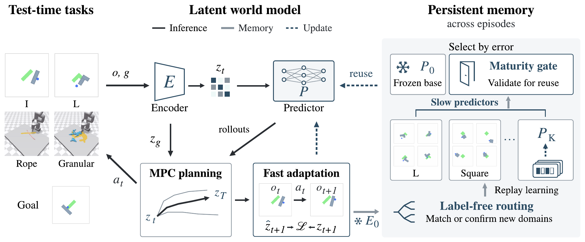
</p>

Each episode starts from working copies of the frozen pretrained encoder–predictor pair $(E_0, P_0)$, which
are never overwritten.

| Component | What it does |
|---|---|
| **Fast adaptation** (within an episode) | After every replan, one Adam step on the recently executed transitions adapts the predictor's last block and the encoder head. The change is discarded at the end of the episode. |
| **Replay consolidation** (across episodes) | Trajectories are re-encoded by the frozen $E_0$, so cross-episode learning stays in a fixed latent space. Each predictive domain keeps its own replay buffer and a slow predictor initialized from $P_0$. |
| **Label-free domain discovery** | A familiarity gate keeps out episodes that $P_0$ already predicts. Fast-update fingerprints propose candidate domains, and prediction errors decide whether a trajectory is accepted. A new domain is founded only when several pending episodes agree, and validated merging and fragment absorption combine domains. |
| **Maturity gate** | A slow predictor becomes eligible for retrieval only after it predicts new, not-yet-trained-on trajectories better than $P_0$. |
| **Validated retrieval** | During the first replans of an episode, the planner switches to whichever of $P_0$ and the mature slow predictors best predicts the transitions observed so far. |

### Writing experience into memory

At the end of an episode, SE-JEPA decides where its experience goes. A familiar episode is skipped. An
episode that read a slow predictor is validated against it (error ratio ≤ 1.2) before being written. An
episode planned with $P_0$ is matched by its fast-update fingerprint, or waits in the pending pool until
enough similar episodes found a new domain. Replay then trains the matching slow predictor.

<p align="center">
  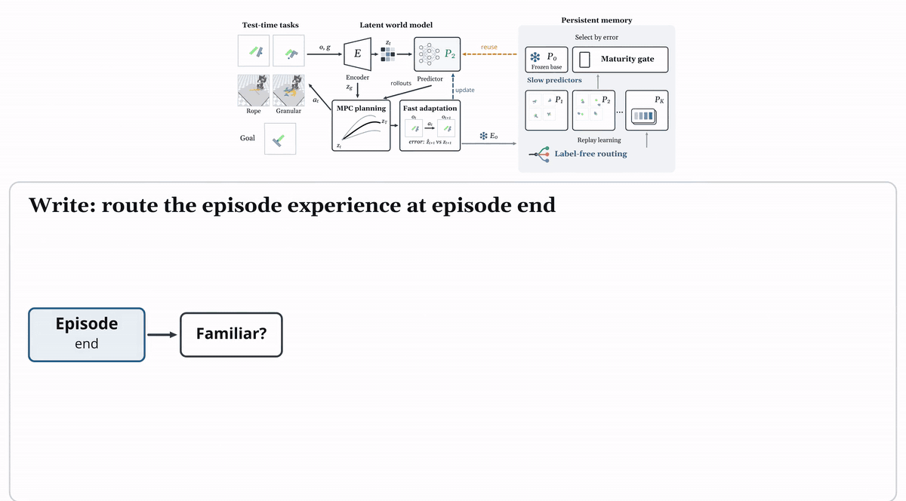
</p>

<sub>Excerpt of the method video at 1.5× speed. The full 1080p video is `assets/videos/method.mp4`
(download it with the <i>Raw</i> button).</sub>

## Results

### Held-out planning after learning

Success (%) and mean MPC replans on test goals excluded from memory learning. The learned memory is
read-only; retrieval and fast adaptation stay active. *Unseen* averages the shapes absent from pretraining
(I, square, small tee); *Shift* averages the six visual shifts (blur, noise, dark, red agent, red object,
red goal). Failures count as 30 replans.

<table>
  <thead>
    <tr><th rowspan="2">Planner</th><th rowspan="2">Method</th><th colspan="3">PushObj (shape shifts)</th><th colspan="3">PushT (visual shifts)</th></tr>
    <tr><th>All-7 ↑</th><th>Unseen ↑</th><th>Replans ↓</th><th>All-7 ↑</th><th>Shift ↑</th><th>Replans ↓</th></tr>
  </thead>
  <tbody>
    <tr><td rowspan="3">GD</td><td>Frozen</td><td>42.5</td><td>32.4</td><td>20.02</td><td>44.1</td><td>41.6</td><td>19.94</td></tr>
    <tr><td>AdaJEPA</td><td>72.2</td><td>55.3</td><td>14.52</td><td>58.7</td><td>54.9</td><td>17.96</td></tr>
    <tr><td><b>SE-JEPA</b></td><td><b>81.6</b></td><td><b>72.4</b></td><td><b>11.30</b></td><td><b>75.7</b></td><td><b>73.6</b></td><td><b>13.21</b></td></tr>
    <tr><td rowspan="3">CEM</td><td>Frozen</td><td>43.8</td><td>36.2</td><td>21.08</td><td>50.9</td><td>48.3</td><td>19.56</td></tr>
    <tr><td>AdaJEPA</td><td>70.4</td><td>54.4</td><td>16.02</td><td>63.0</td><td>60.2</td><td>17.87</td></tr>
    <tr><td><b>SE-JEPA</b></td><td><b>79.1</b></td><td><b>69.9</b></td><td><b>13.53</b></td><td><b>77.1</b></td><td><b>76.1</b></td><td><b>14.15</b></td></tr>
  </tbody>
</table>

<table>
  <tr>
    <td width="50%" align="center">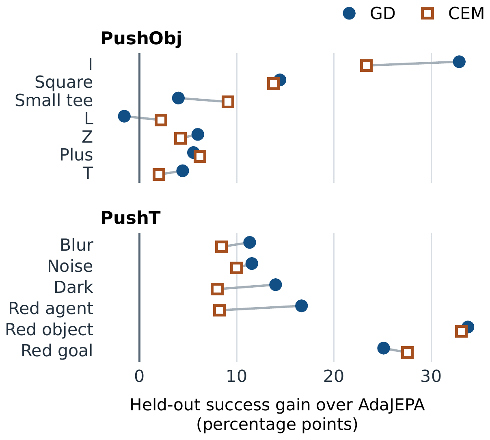</td>
    <td width="50%" align="center">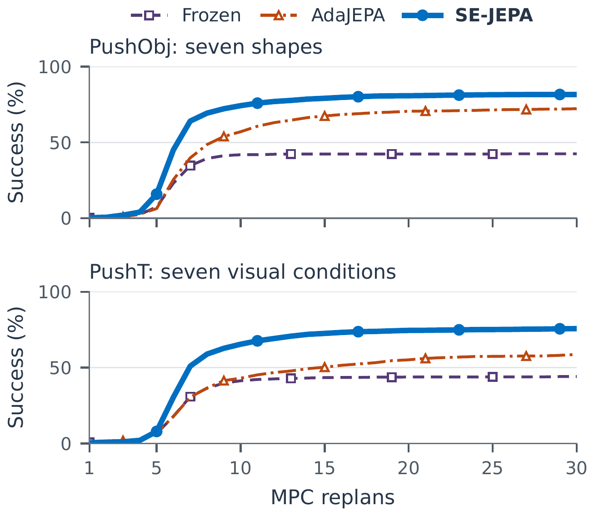</td>
  </tr>
  <tr>
    <td align="center"><b>Held-out gains over AdaJEPA per condition.</b> The largest gains are on the unseen I and square shapes and on object / goal recoloring.</td>
    <td align="center"><b>Planning efficiency (GD).</b> Within 15 replans, SE-JEPA already exceeds AdaJEPA's success at the full 30-replan budget.</td>
  </tr>
</table>

### Learning from deployment experience

<p align="center">
  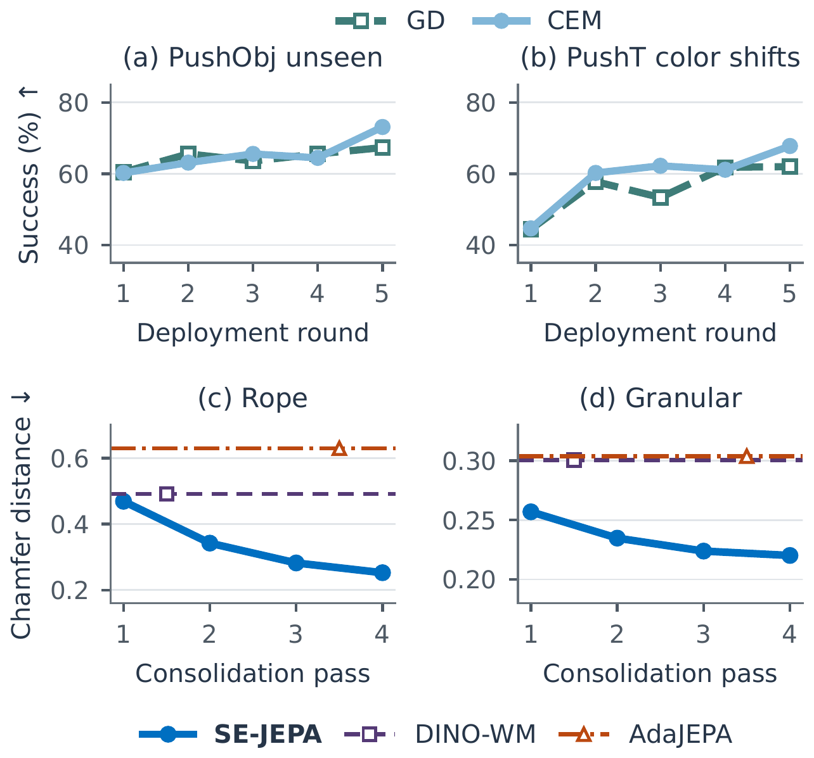
</p>

**(a, b)** Online success on unseen PushObj shapes and PushT color shifts rises across five rounds, although
goals are resampled every round. **(c, d)** With fast adaptation disabled, revisiting 50 rope / granular
instances lowers the final Chamfer distance (CD) pass by pass:

| Final CD ↓ (15 pushes) | Rope | Granular |
|---|---|---|
| DINO-WM (frozen) | 0.491 | 0.301 |
| AdaJEPA | 0.629 | 0.304 |
| **SE-JEPA**, pass 4, no fast adaptation | **0.252** | **0.220** |

On **91 new rope instances** excluded from learning, the predictor after a single consolidation pass lowers
mean final CD from 0.664 (pretrained DINO-WM) to **0.349 (−47%)**, with both predictors fixed.

### One memory across recurring conditions

<p align="center">
  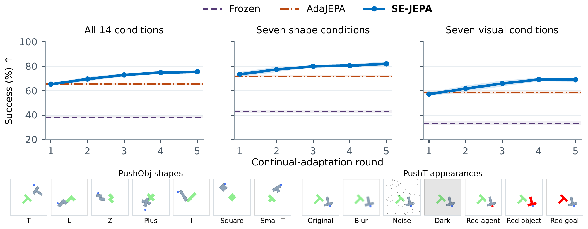
</p>

One stream mixes 7 PushObj shapes and 7 PushT visual conditions over five rounds, with a single persistent
memory. Averaged over GD and CEM, online success rises from **65.3% to 75.5%** (shapes 73.4% → 82.0%,
visual 57.2% → 68.9%). In round five, SE-JEPA reaches 75.1% (GD) and 75.8% (CEM), compared with 65.1% / 65.4%
for AdaJEPA and 37.7% / 38.6% for the frozen model.

When rope and granular tasks alternate in one CEM stream, SE-JEPA forms two predictive domains **without
material labels**:

| Round | Rope CD ↓ | Granular CD ↓ | Domain purity (%) ↑ | Retrieval accuracy (%) ↑ |
|:---:|:---:|:---:|:---:|:---:|
| 1 | 0.598 | 0.471 | 100 | 96.6 |
| 2 | 0.452 | 0.369 | 100 | 100.0 |
| 3 | 0.412 | 0.355 | 100 | 100.0 |

### Qualitative results

All examples use matched start states and goals. Playback is rescaled for presentation and does not reflect
runtime.

**PushT / PushObj: AdaJEPA vs. SE-JEPA**

<p align="center">
  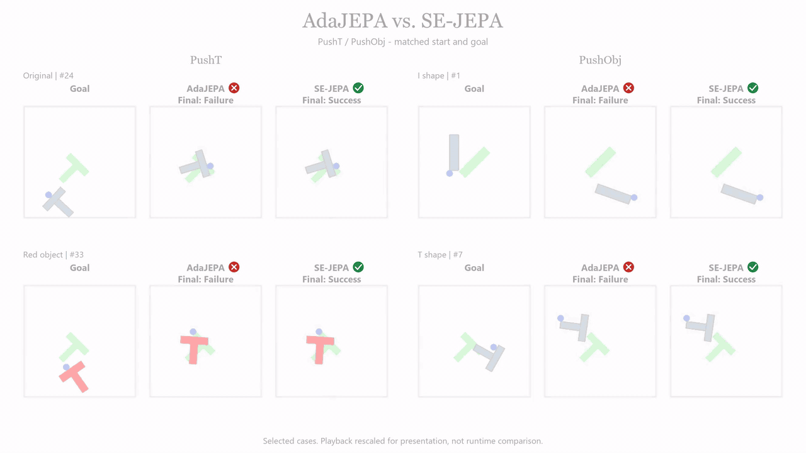
</p>

**Rope / Granular: frozen DINO-WM vs. SE-JEPA** (final Chamfer distance, lower is better)

<p align="center">
  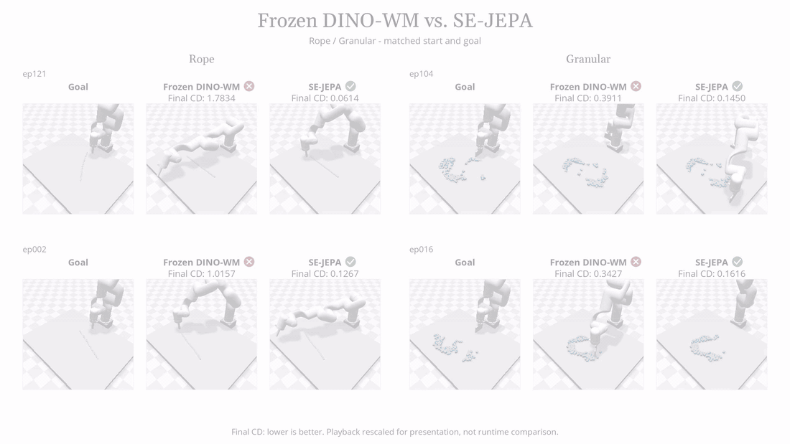
</p>

<details>
<summary><b>Final states from the paper</b> (click to expand)</summary>

<p align="center">
  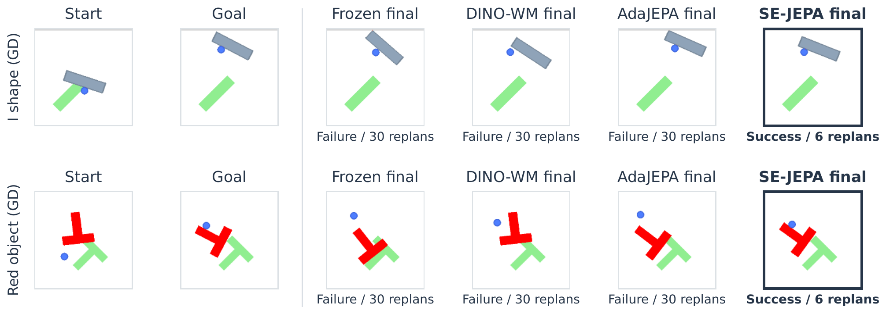
</p>
<p align="center">
  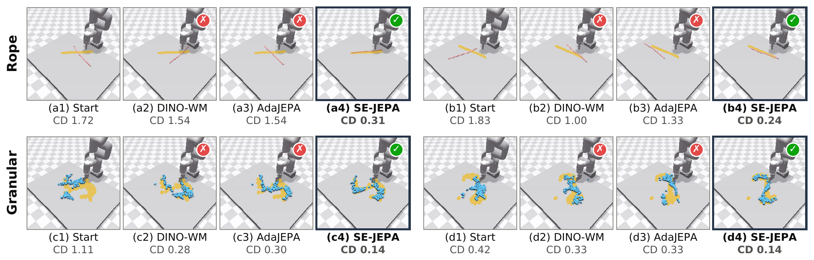
</p>

</details>

<details>
<summary><b>Ablations</b> (click to expand)</summary>

**Inheriting fast weights does not transfer.** Fast updates are accumulated as $s_{e+1} = s_e + w\Delta_e$
on 100 matched PushObj goals; wins / losses are relative to episodic reset.

| Accumulation $w$ | Success (%) | Wins / losses |
|---|:---:|:---:|
| 0 (episodic reset) | 62.0 | – |
| 0.003 | 64.0 | 7 / 5 |
| 0.01 | 59.0 | 5 / 8 |
| 0.03 | 54.0 | 4 / 12 |
| 1 (naive inheritance) | 48.0 | 11 / 25 |

**Error-guided predictor selection** on new PushT trajectories (future latent MSE, ×10⁻³):

| Predictor selection | One-step ↓ | Five-step ↓ |
|---|:---:|:---:|
| Pretrained predictor | 58.15 | 88.94 |
| Fixed domain + pretrained | 22.12 | 47.47 |
| Random eligible predictor | 46.74 | 81.22 |
| **Error-based selection (ours)** | **13.03** | **31.54** |
| Future-error oracle | 11.79 | 27.83 |

**Specialization with retention (GD).** After seven rounds of only the I shape:

| Method | I success (%) ↑ | Other 6 shapes (%) ↑ | I replans ↓ |
|---|:---:|:---:|:---:|
| Episodic reset | 47.33 | 81.89 | 20.18 |
| Fast-weight inheritance | 38.00 | 33.78 | 22.19 |
| **SE-JEPA** | **76.67** | **81.78** | **12.04** |

</details>

## Repository structure

```
SE-JEPA/
├── plan.py                     # planning / evaluation entry point (Hydra)
├── train.py                    # world-model training entry point (Hydra)
├── conf/                       # Hydra configs
│   ├── sejepa_gd_pushobj.yaml      # SE-JEPA + GD planner   (PushObj, PushT)
│   ├── sejepa_cem_pushobj.yaml     # SE-JEPA + CEM planner  (PushObj, PushT)
│   ├── sejepa_cem_deformable.yaml  # SE-JEPA + CEM planner  (rope, granular)
│   ├── train_pushobj_bias16k.yaml  # world model for PushObj (shapes T, L, Z, +)
│   ├── train_pushobj_T16k.yaml     # world model for PushT   (shape T)
│   └── encoder/ predictor/ decoder/ action_encoder/ proprio_encoder/ env/
├── planning/                   # planners
│   ├── sejepa.py                   # SE-JEPA planner (SEJEPAMPCPlanner)
│   ├── continual.py                # fast/slow weights, per-domain slow predictors, gates
│   ├── continual_merge.py          # validated domain merging
│   ├── adajepa*.py                 # within-episode fast adaptation (AdaJEPA)
│   ├── mpc.py gd.py cem.py         # MPC loop and action optimizers
│   ├── objectives.py evaluator.py  # planning objective and evaluation
│   └── image_corruption.py         # PushT visual shifts (blur, salt-and-pepper, dark)
├── models/                     # encoders, ViT predictor, decoder, world model
├── datasets/                   # PushT / PushObj and deformable datasets
├── env/                        # PushT / PushObj and rope / granular (PyFleX) environments
├── metrics/                    # image metrics (LPIPS)
├── distributed_fn/             # multi-GPU training helpers
├── utils/                      # shared helpers, observation preprocessor, OmegaConf resolvers
├── scripts/
│   ├── build_streams.py            # build PushObj / PushT deployment streams
│   ├── run_stream.py               # run a stream with SE-JEPA, AdaJEPA or a frozen model
│   ├── calibrate_familiarity.py    # familiarity threshold for a checkpoint
│   ├── gen_pushobj_dataset.py      # generate PushObj / PushT training data
│   └── deformable/                 # targets and stream runs for rope / granular
├── docs/
│   ├── REPRODUCE.md                # full settings and commands for every experiment
│   └── IMPLEMENTATION.md           # paper-to-code map, planner hierarchy, CUDA-graph GD
└── assets/                     # README figures and animations
    └── videos/                     # 1080p videos (method, demos, summary)
```

## Getting started

### Installation

```bash
git clone https://github.com/Celveen/SE-JEPA.git
cd SE-JEPA
conda create -n sejepa python=3.10 -y && conda activate sejepa
pip install -r requirements.txt
```

Install the `torch` / `torchvision` builds that match your CUDA driver. Rope / granular experiments also need
PyFleX (see [docs/REPRODUCE.md](docs/REPRODUCE.md#1-installation)).

### Quick start

Model weights and datasets are not included. Once a world-model checkpoint is available (see
[Data and world models](docs/REPRODUCE.md#2-data-and-world-models)), build a deployment stream and run SE-JEPA
on it:

```bash
# 1. a PushObj shape-shift stream (5 rounds x 7 shapes)
python scripts/build_streams.py shape --name shape_s100 --seeds 100 200 300 1000 1100

# 2. SE-JEPA with the GD planner; chunks run as one chain through the persistent memory
python scripts/run_stream.py --stream shape_s100 --method sejepa --config sejepa_gd_pushobj \
    --ckpt /abs/path/to/checkpoints/pushobj_bias_16k_e3_seed0 --epoch 3 --gpus 0
```

Add `--max-episodes 1` for a smoke test. Use `--method adajepa` or `--method frozen` for the baselines.
Each chunk writes its success rate, per-episode routing decisions and the memory state to
`eval_outputs/<stream>/<method>/chunk_<k>_<tag>/`.

See **[docs/REPRODUCE.md](docs/REPRODUCE.md)** for the full settings, the PushT, rope and granular streams,
held-out evaluation and the baselines.

## Citation

If you find this work useful, please cite:

```bibtex
@article{sejepa2026,
  title   = {SE-JEPA: Self-Evolving Latent World Models},
  author  = {Anonymous},
  year    = {2026}
}
```

## Acknowledgements

This code builds on [DINO-WM](https://github.com/gaoyuezhou/dino_wm) (world model, environments, datasets and
training) and follows the within-episode adaptation and PushObj evaluation protocol of AdaJEPA. The deformable
environments use PyFleX, and the LPIPS metric is a PyTorch port of
[LPIPS](https://github.com/richzhang/PerceptualSimilarity). We thank the authors for releasing their code.

## License

This project is released under the [MIT License](LICENSE).
