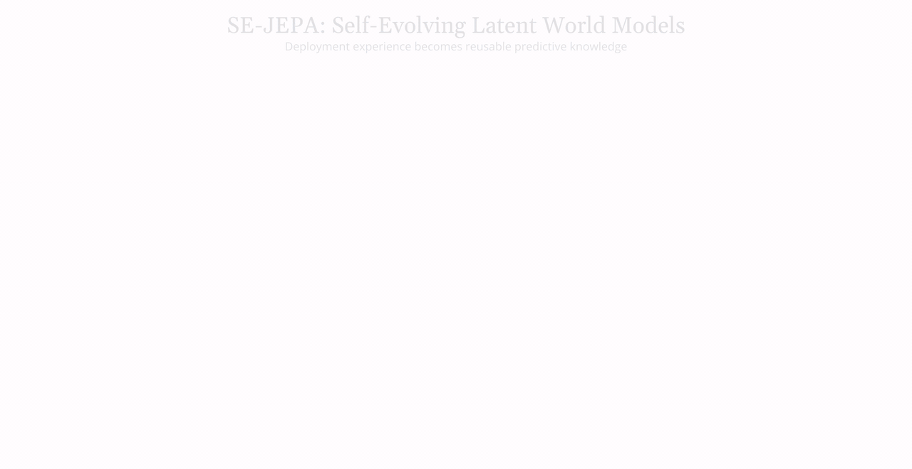

<p align="right">
  <a href="README.md"></a>
  <a href="README.zh-CN.md"></a>
</p>

<div align="center">

# SE-JEPA: Self-Evolving Latent World Models

**将部署经验转化为可复用的预测知识**

[](https://12138tyy.github.io/SE-pages/)
[](#citation)
[](LICENSE)



</div>

SE-JEPA 让潜在空间世界模型能够**跨部署回合持续学习**，同时保留预训练阶段学到的知识。它不直接将单个回合的权重更新延续到后续回合，而是回放已观测到的交互轨迹，将相容的轨迹归入**自主发现的预测域**，为**每个预测域训练一个慢预测器**，并在相应条件再次出现时**检索**经过验证的预测器。整个过程无需域标签或域切换信号，并同时支持梯度下降（GD）和交叉熵方法（CEM）规划器。

## 论文亮点

- 在预训练阶段未见过的 PushObj 形状上，留出测试集的成功率较 AdaJEPA 提高 **+15.4 至 +17.1 个百分点**；在 PushT 视觉变化任务上提高 **+15.9 至 +18.7 个百分点**（GD 和 CEM）。
- 在混合了 14 种形状与视觉条件的单一部署流中，使用同一份持久记忆，经过五轮运行，在线成功率从 **65.3% 提升至 75.5%**。
- 以 DINO-WM 为骨干模型，预测器仅经过**一轮知识整合训练**，便在未参与学习的绳索实例上将 Chamfer 距离降低 **47%**，且无需任何回合内自适应。

## 代码结构

```
SE-JEPA/
├── plan.py                     # 规划 / 评估入口（Hydra）
├── train.py                    # 世界模型训练入口（Hydra）
├── conf/                       # Hydra 配置
│   ├── sejepa_gd_pushobj.yaml      # SE-JEPA + GD 规划器（PushObj、PushT）
│   ├── sejepa_cem_pushobj.yaml     # SE-JEPA + CEM 规划器（PushObj、PushT）
│   ├── sejepa_cem_deformable.yaml  # SE-JEPA + CEM 规划器（绳索、颗粒物）
│   ├── train_pushobj_bias16k.yaml  # PushObj 世界模型（T、L、Z、+ 形状）
│   ├── train_pushobj_T16k.yaml     # PushT 世界模型（T 形状）
│   └── encoder/ predictor/ decoder/ action_encoder/ proprio_encoder/ env/
├── planning/                   # 规划器
│   ├── sejepa.py                   # SE-JEPA 规划器（SEJEPAMPCPlanner）
│   ├── continual.py                # 快 / 慢权重、各域慢预测器、门控机制
│   ├── continual_merge.py          # 经过验证的域合并
│   ├── adajepa*.py                 # 回合内快速自适应（AdaJEPA）
│   ├── mpc.py gd.py cem.py         # MPC 循环与动作优化器
│   ├── objectives.py evaluator.py  # 规划目标与评估
│   └── image_corruption.py         # PushT 视觉变化（模糊、椒盐噪声、变暗）
├── models/                     # 编码器、ViT 预测器、解码器、世界模型
├── datasets/                   # PushT / PushObj 与可变形物体数据集
├── env/                        # PushT / PushObj 与绳索 / 颗粒物（PyFleX）环境
├── metrics/                    # 图像指标（LPIPS）
├── distributed_fn/             # 多 GPU 训练辅助工具
├── utils/                      # 通用工具、观测预处理器、OmegaConf 解析器
├── scripts/
│   ├── build_streams.py            # 构建 PushObj / PushT 部署流
│   ├── run_stream.py               # 使用 SE-JEPA、AdaJEPA 或冻结模型运行部署流
│   ├── calibrate_familiarity.py    # 为模型检查点确定熟悉度阈值
│   ├── gen_pushobj_dataset.py      # 生成 PushObj / PushT 训练数据
│   └── deformable/                 # 绳索 / 颗粒物的目标与部署流运行脚本
├── docs/
│   ├── REPRODUCE.md                # 各项实验的完整设置与命令
│   └── IMPLEMENTATION.md           # 论文与代码对应关系、规划器层级、CUDA Graph GD
└── assets/                     # README 图片与动画
    └── videos/                     # 1080p 视频（方法、演示、总结）
```

## 使用教程

> [!IMPORTANT]
> **📌 详细实验设置请参阅 [docs/REPRODUCE.zh-CN.md](docs/REPRODUCE.zh-CN.md)。**

### 环境安装

```bash
git clone https://github.com/Celveen/SE-JEPA.git
cd SE-JEPA
conda create -n sejepa python=3.10 -y && conda activate sejepa
pip install -r requirements.txt
```

绳索 / 颗粒物实验还需要安装 PyFleX，详见 [docs/REPRODUCE.md](docs/REPRODUCE.md#1-installation)。

### 快速上手

本仓库不包含模型权重和数据集。准备好世界模型检查点后（参见[数据与世界模型](docs/REPRODUCE.md#2-data-and-world-models)），即可构建部署流并运行 SE-JEPA：

```bash
# 1. 构建 PushObj 形状变化部署流（5 轮 × 7 种形状）
python scripts/build_streams.py shape --name shape_s100 --seeds 100 200 300 1000 1100

# 2. 使用 GD 规划器运行 SE-JEPA；各数据块通过持久记忆串联运行
python scripts/run_stream.py --stream shape_s100 --method sejepa --config sejepa_gd_pushobj \
    --ckpt /abs/path/to/checkpoints/pushobj_bias_16k_e3_seed0 --epoch 3 --gpus 0
```

添加 `--max-episodes 1` 可进行冒烟测试。使用 `--method adajepa` 或 `--method frozen` 可运行对应基线。
每个数据块的成功率、各回合的路由决策以及记忆状态都会写入
`eval_outputs/<stream>/<method>/chunk_<k>_<tag>/`。

<a name="citation"></a>

## 引用

如果本工作对您有所帮助，欢迎引用：

```bibtex
@article{sejepa2026,
  title   = {SE-JEPA: Self-Evolving Latent World Models},
  author  = {Anonymous},
  year    = {2026}
}
```

## 致谢

本代码基于 [DINO-WM](https://github.com/gaoyuezhou/dino_wm) 的世界模型、环境、数据集与训练代码构建，并遵循 AdaJEPA 的回合内自适应方法与 PushObj 评估协议。可变形物体环境使用 PyFleX，LPIPS 指标采用 [LPIPS](https://github.com/richzhang/PerceptualSimilarity) 的 PyTorch 实现。感谢相关作者开源代码。

## 许可证

本项目采用 [MIT 许可证](LICENSE) 发布。
