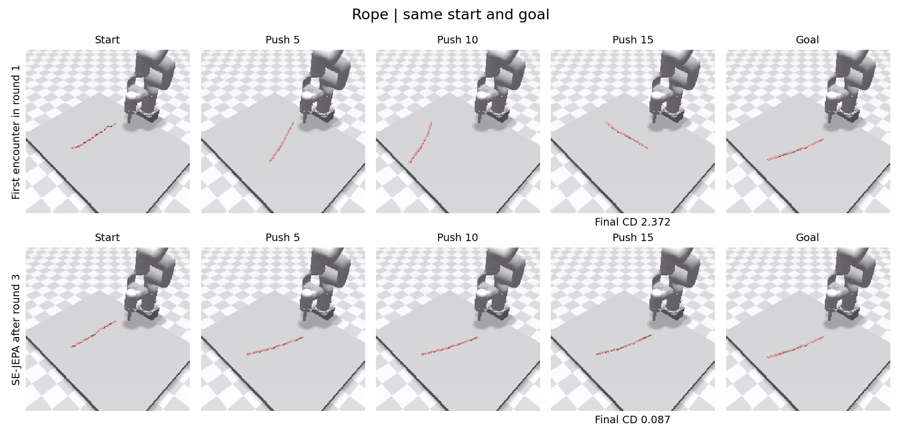
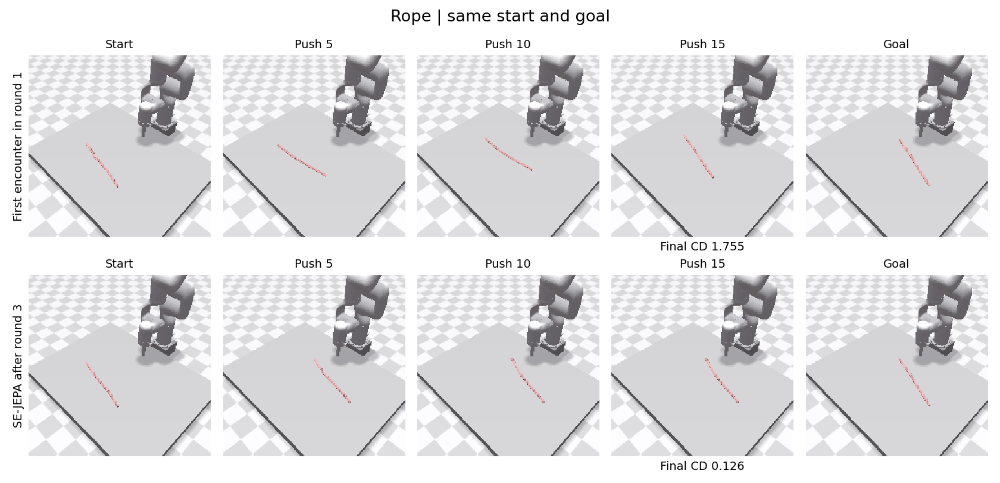
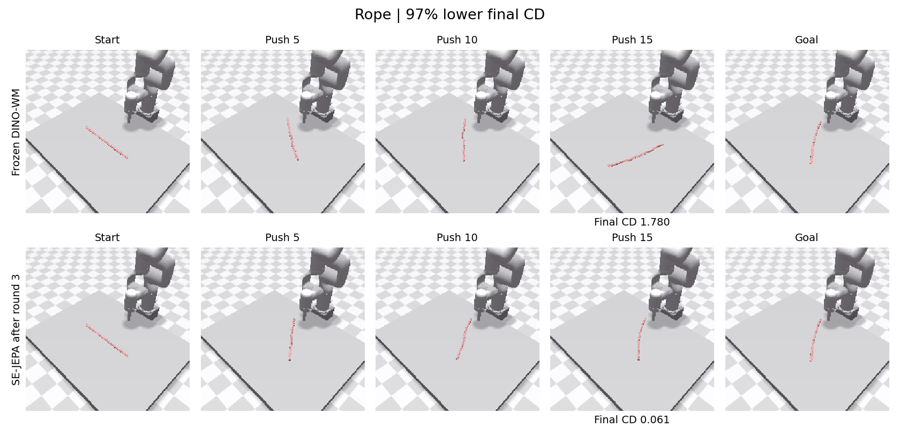
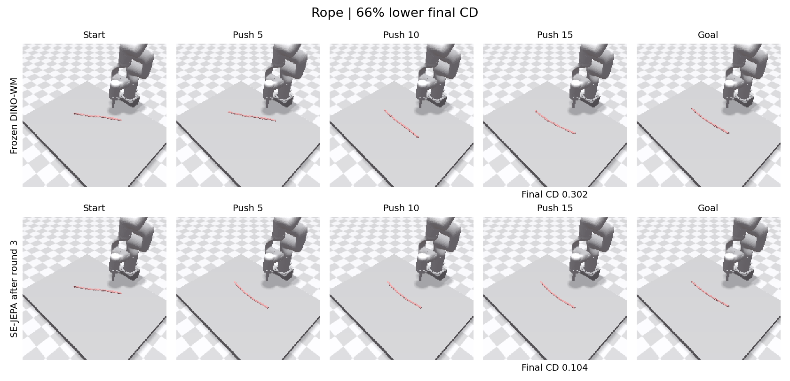
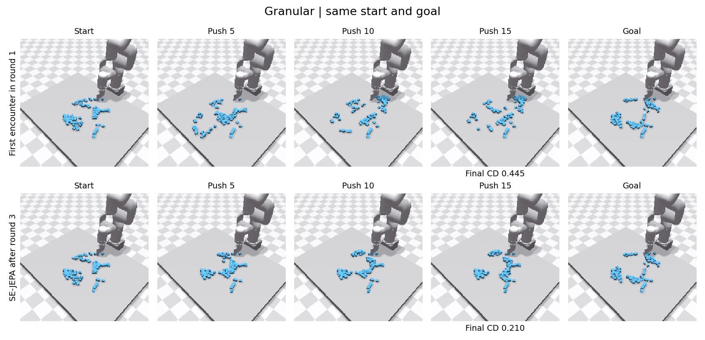
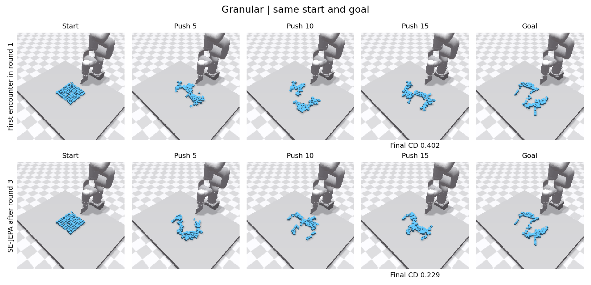
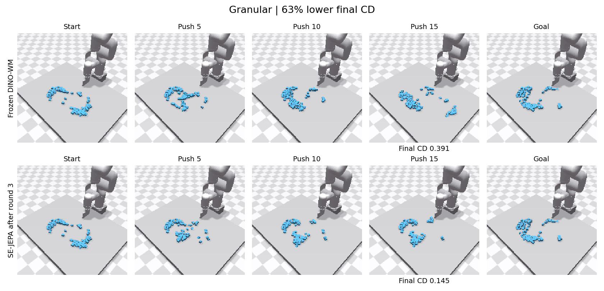
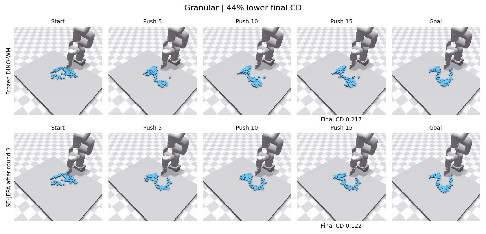

# Rope / Granular 真实机械臂仿真素材

这组素材展示持续学习如何改善可变形物体的目标形状控制。Rope 和 Granular 各提供四组案例，其中两组展示第一轮首次执行与第三轮学习后的变化，两组展示第三轮模型相对 Frozen DINO-WM 的改善。每组使用相同起点和目标，以最终粒子 Chamfer Distance（CD，越低越好）标注效果。

所有场景图片均来自 PyFleX 机械臂仿真。原始 PNG 保持 224×224 分辨率和原始像素，拼图另加步骤与 CD 标签。

## 八组案例

| 物体 | 案例与拼图 | 对比 | 起始方案 CD | 第三轮 CD | CD 降低 |
|---|---|---|---:|---:|---:|
| rope | [rope_continual_01](rope_continual_01/storyboard.png) | 第一轮首次执行 → 第三轮 | 2.3723 | 0.0875 | 96.3% |
| rope | [rope_continual_02](rope_continual_02/storyboard.png) | 第一轮首次执行 → 第三轮 | 1.7552 | 0.1264 | 92.8% |
| rope | [rope_baseline_01](rope_baseline_01/storyboard.png) | Frozen DINO-WM → 第三轮 | 1.7795 | 0.0613 | 96.6% |
| rope | [rope_baseline_02](rope_baseline_02/storyboard.png) | Frozen DINO-WM → 第三轮 | 0.3024 | 0.1042 | 65.5% |
| granular | [granular_continual_01](granular_continual_01/storyboard.png) | 第一轮首次执行 → 第三轮 | 0.4455 | 0.2100 | 52.9% |
| granular | [granular_continual_02](granular_continual_02/storyboard.png) | 第一轮首次执行 → 第三轮 | 0.4023 | 0.2285 | 43.2% |
| granular | [granular_baseline_01](granular_baseline_01/storyboard.png) | Frozen DINO-WM → 第三轮 | 0.3911 | 0.1450 | 62.9% |
| granular | [granular_baseline_02](granular_baseline_02/storyboard.png) | Frozen DINO-WM → 第三轮 | 0.2173 | 0.1216 | 44.0% |

## 剪辑素材位置

- 每组的 `storyboard.png` 展示起点、第 5、10、15 次推动及目标。
- `round3/keyframes/push_00.png` 至 `push_15.png` 是第三轮模型重评同一目标时的逐推动关键帧。`round3/motion_frames/frame_*.png` 是机械臂运动过程的连续采样帧。
- 持续学习组的 `round1_online/keyframes/` 保存第一轮实际执行时留存的 16 张原始观察图。`round1/` 保存第一轮末模型的同随机种子重评，`checkpoint_comparison.png` 展示这一补充对比。
- Frozen 对比组的 `frozen/` 保存物体对应的原始 DINO-WM 模型执行过程。
- `goal.png` 是对应任务的目标图，`frames.json` 给出运动帧顺序、推动编号和原始 RGB 校验值。
- 运动帧沿用仿真器的接触 / 非接触采样间隔，因此帧间物理时间并不恒定。按文件名排序可用于剪辑，展示播放速度由剪辑决定。

## 实验口径

Rope 使用 Rope DINO-WM 初始化，Granular 使用 Granular DINO-WM 初始化，各自完成三轮持续学习，每轮 50 个不同任务，前三轮源验证轨迹分组互不重叠。展示中的第三轮结果使用累计 150 个任务后保存的 predictor，固定该模型后重新执行同一起点与目标。第四轮实验独立进行，此素材统一使用第三轮权重。

首次执行对比的上排来自第一轮在线过程，下排来自第三轮模型的回访。首次在线运行保留当时的随机数过程。另附的第一轮末 / 第三轮末模型对比，以及 Frozen / 第三轮模型对比，均固定相同的环境种子、规划种子、动作归一化、DINOv2 编码器及规划预算，评测时不更新模型。

CEM 使用 300 个候选、top-30、10 次优化、5 步规划；MPC 执行 3 轮，每轮 5 次推动，共 15 次。CD 在第 5、10、15 次推动后计算，定义为双方点集最近邻欧氏距离均值之和，取粒子前三个坐标。

这八组是从 16 个候选任务、48 次配对模型评测中按效果差异筛选的定性展示案例，筛选口径见 `selection.json`。候选及全部已完成评测结果保留在 `screening.csv`，逐组来源、轨迹编号、窗口偏移、随机种子及权重校验值见 `metadata.json`。`comparisons.csv` 同时保存首次在线对比与固定模型对比的数值。前三轮共 300 个任务的原始逐任务结果、轮次汇总与目标来源保留在 `training_evidence/`。

## 文件与复现

每个执行方案保留原始粒子轨迹 `particle_states.npz`、CD 日志、预处理统计、记录清单与 `reproduce.json`。每组保留同一份 `target.pkl`。`validation.json` 记录对原始 RGB、起点 / 目标一致性及粒子 CD 的独立复核。

复现需要本仓库的 PyFleX 环境、对应物体的 DINO-WM 基座、原始动作统计文件、DINOv2 ViT-S/14 缓存以及相应持续学习模型。`reproduce.json` 保留本次机器上的完整路径；在其他机器运行前，将其中的路径改为实际位置。checkpoint 的 SHA-256 见每组 `metadata.json`。

```bash
PYTHONPATH="$PWD" TORCH_FORCE_NO_WEIGHTS_ONLY_LOAD=1 python scripts/record_deformable_case.py media/robot_arm_qualitative/<group>/<arm>/reproduce.json
python scripts/validate_deformable_frames.py media/robot_arm_qualitative
```

录制脚本 `scripts/record_deformable_case.py` 从仿真器原有的采样调用读取图像，不增加渲染或物理步。`scripts/run_deformable_file_targets.py` 使用发布数据的动作统计与固定 DINOv2 权重。`scripts/package_deformable_frames.py` 整理原始帧及展示拼图。

## rope_continual_01



## rope_continual_02



## rope_baseline_01



## rope_baseline_02



## granular_continual_01



## granular_continual_02



## granular_baseline_01



## granular_baseline_02


